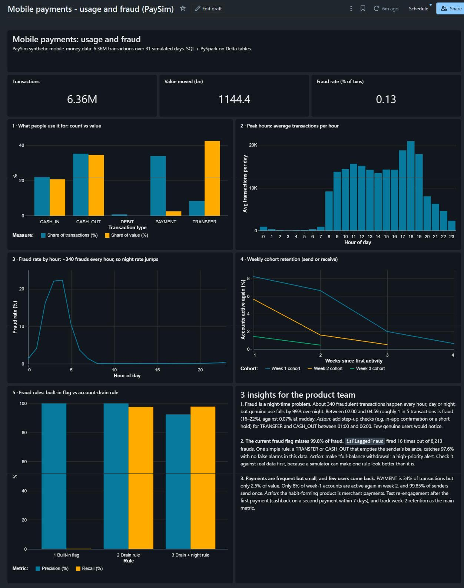
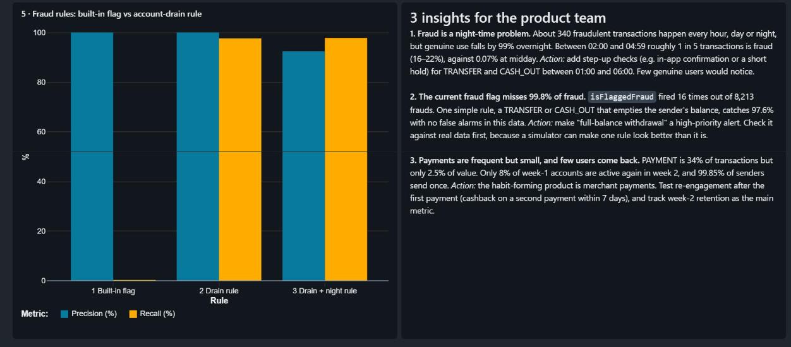

# Mobile payments: user behaviour and fraud analysis in Databricks

Analysis of **6.36 million** synthetic mobile-money transactions ([PaySim](https://www.kaggle.com/datasets/ealaxi/paysim1)), built in **Databricks Free Edition** with SQL, PySpark, Delta tables in Unity Catalog and an AI/BI dashboard.

The questions are the ones a payments product team asks. What do people use the product for? When do they use it? Do new users come back? Where does fraud happen, and does the current fraud flag work?

## Key results

| Metric | Value |
|---|---|
| Transactions / value moved | 6,362,620 / 1.14 trillion (simulated currency) |
| Fraud | 8,213 transactions (0.13%), only in TRANSFER and CASH_OUT |
| Senders who transact more than once | 0.15% |
| Week-1 accounts active again in week 2 | 8.2% |
| Recall of the built-in fraud flag | 0.2% (16 of 8,213) |
| Recall / precision of the "account drained" rule | 97.6% / 100% |

## 3 insights a product team could act on

1. **Fraud is a night-time problem.** About 340 frauds happen every hour, day or night, but genuine use falls by 99% overnight. Between 02:00 and 04:59 about 1 in 5 transactions is fraud (16–22%), against 0.07% at midday. → Add step-up checks for night-time TRANSFER and CASH_OUT. Few genuine users would notice.
2. **The current fraud flag misses 99.8% of fraud.** A single rule, a transfer or cash-out that empties the sender's balance, catches 97.6% with no false alarms here. → Make full-balance withdrawals a high-priority alert, after testing it on real data. A simulator can make one rule look better than it is.
3. **Payments are frequent but small, and few users come back.** PAYMENT is 34% of transactions but 2.5% of value. Week-2 retention is 8%. → Merchant payments are where habits form. Test a second-payment incentive and track week-2 retention.

## Project structure

| Path | What it does |
|---|---|
| [`notebooks/00_load_data.py`](notebooks/00_load_data.py) | Creates `workspace.paysim` and a volume, downloads the Kaggle file, writes the typed bronze Delta table |
| [`notebooks/01_profiling_quality.sql`](notebooks/01_profiling_quality.sql) | SQL profiling, 12 data-quality checks saved to `dq_results` (PASS/WARN/FAIL), and the silver table with time columns |
| [`notebooks/02_product_usage_analysis.py`](notebooks/02_product_usage_analysis.py) | PySpark: transactions per user, type mix, weekly cohorts and retention, peak hours, fraud patterns and rule comparison. Writes `gold_*` tables |
| [`dashboard/paysim_mobile_payments.lvdash.json`](dashboard/paysim_mobile_payments.lvdash.json) | The AI/BI dashboard (5 charts, 3 KPI counters, insights), importable into Databricks |
| [`dashboard/build_dashboard.py`](dashboard/build_dashboard.py) | Generates the dashboard JSON (datasets, widgets, layout) from code, so the dashboard is version-controlled |
| [`AI_CHECK.md`](AI_CHECK.md) | Where the AI assistant's code or assumptions were wrong, and how each was caught |
| [`verification/crosscheck.py`](verification/crosscheck.py) | Recomputes the key numbers with DuckDB, separately from Spark |

Data flow: Kaggle CSV → volume → `bronze_transactions` → quality checks → `silver_transactions` → `gold_*` tables → dashboard.

## Data quality summary

All blocking checks pass: row count, nulls, duplicates, valid types, step range, ID prefixes and flag consistency. Three warnings are kept and documented rather than "fixed":

- **16 zero-amount rows**, all CASH_OUT fraud. Excluded from usage metrics, kept for fraud analysis.
- **2.5M sender-balance mismatches** in TRANSFER/CASH_OUT. This is known simulator behaviour, so balances are not treated as ground truth.
- **Activity falls sharply after day 17**, while fraud stays at about 215–320 a day. Later cohorts are smaller, so read their retention with care.

## AI check (summary)

An AI assistant drafted much of the code. It was right about syntax and boilerplate, and wrong on **assumptions about the data**. It proposed *monthly* cohorts on a 31-day dataset. It defined retention on senders, 99.85% of whom transact once. It mixed two hour-of-day conventions, which shifted the fraud peak by an hour. It repeated a documented flag rule that the data contradicts. Each mistake was caught by a query designed to prove the assumption wrong, and the headline numbers were recomputed in a second engine (DuckDB). Full table: [AI_CHECK.md](AI_CHECK.md).

## How to run

1. Create a [Databricks Free Edition](https://www.databricks.com/learn/free-edition) workspace.
2. Import the `notebooks/` folder into your workspace, or clone this repo as a Git folder.
3. Run `00` → `01` → `02` on serverless compute. If the Kaggle download is blocked, upload the CSV to the `raw` volume by hand.
4. Dashboards → Import → `dashboard/paysim_mobile_payments.lvdash.json`, then publish.
5. Optional: `pip install duckdb` and run `python verification/crosscheck.py <path-to-csv>`.

## Limitations

PaySim is **synthetic**. It was generated from one month of aggregated logs of a real mobile-money service in Africa, so patterns that look perfect, such as the drain rule, may be artefacts of the simulator. "Hour of day" assumes step 1 starts at 00:00. Amounts are in an unnamed currency.

*Data: E. A. Lopez-Rojas, A. Elmir and S. Axelsson, "PaySim: A financial mobile money simulator for fraud detection", EMSS 2016.*
